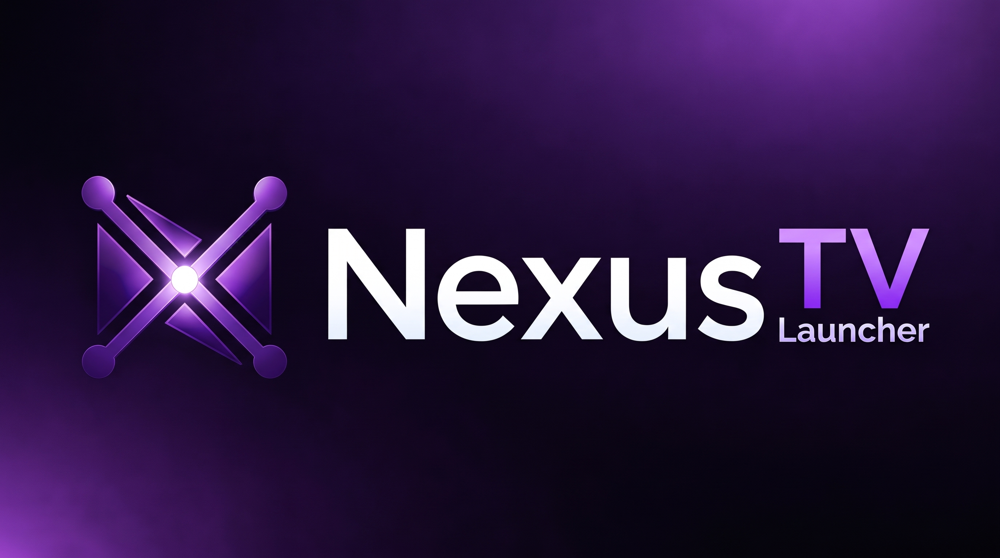

<p align="center">
  <a href="https://github.com/bendourthe/nexus-tv-launcher">
    
  </a>
</p>

<p align="center">
  <em>A Clean, Modern, Ad-Free Home Screen for Android TV, Google TV, and Fire TV.</em>
</p>

---

# Nexus TV Launcher

**Nexus TV Launcher** is a lightweight, ad-free, high-performance custom launcher engineered specifically for Android TV, Google TV, and Fire TV devices. It completely replaces the bloated, recommendation-heavy stock interfaces with a sleek, minimalist home screen featuring fluid GPU-accelerated wave wallpapers, unified Continue Watching shelves, multi-profile user management with custom avatars, and zero-flicker wake masking.

---

## Key Highlights

- **Zero Ads and Clutter**: No sponsored banners, promotional auto-playing videos, or forced recommendation tiles.
- **Zero-Flicker Instant Wake**: Specialized accessibility overlay service runs at Layer 29 (`TYPE_ACCESSIBILITY_OVERLAY`) to completely occlude the stock launcher during device power-on, screen wake, and Home button presses.
- **Unified "Continue Watching" Shelf**: Aggregates playback history and deep links directly into Disney+, HBO Max, Apple TV+, Prime Video, Netflix, Peacock, and Hulu with entity UUID deep linking.
- **Multi-User Profiles with Custom Avatars**:
  - Dedicated **Account Button** support (`KEYCODE_PROFILE_SWITCH` / keycode 288) triggers the custom User Menu dialog.
  - High-resolution illustrated character avatars across 10 categories (Superheroes, Sci-Fi, Landscapes, Space, Pop Culture, Animals, Cars, Anime, and Abstract) as well as gradient monograms.
  - Instant profile switching with distinct watchlists and preferences per household member.
- **Physical Remote Mapping**:
  - **Account / Profile Key**: Opens the User Menu dialog.
  - **TV Input Key** (`KEYCODE_TV_INPUT` 178 / 171): Opens the TV Inputs dialog (HDMI 1, HDMI 2, Composite, etc.).
  - **Settings Gear Key** (`KEYCODE_SETTINGS` 176 / Quick Settings / Hisense 357): Directly launches the original TV system settings (`com.android.tv.settings/.MainSettings`).
  - **Dedicated App Keys**: Direct fast-path routing for Netflix, Prime Video, YouTube, Disney+, Peacock, and Spotify.
- **Live Local Weather & Time**: Auto-updating location-based weather pill, dynamic greeting, Wi-Fi status, and Bluetooth accessory management.
- **Multi-Device Local Sync**: Automatic UDP peer discovery and state synchronization between TVs on the same local network (`ProfileSyncManager`).
- **Dynamic Themes & 4K Wallpaper Slideshows**:
  - **Dynamic Abstract**: Procedural OpenGL / Canvas undulating ambient wave mesh with multiple colorways (Cosmic Violet, Midnight Cyan, Cyberpunk Neon, Aurora, Solar Flare, Emerald, and Deep Obsidian).
  - **Nature (4K)**: 18 high-resolution curated landscapes (Yosemite, Banff Moraine Lake, Matterhorn, Lofoten Aurora, Grand Canyon, Dolomites, etc.).
  - **Space (4K)**: 17 high-resolution NASA / Webb / Hubble astrophotography images (Carina Nebula, Pillars of Creation, Jupiter Great Red Spot, Saturn Rings, Andromeda, etc.).
  - **Cities (4K)**: 16 high-resolution global skylines (Tokyo, Manhattan, Singapore, Dubai, Paris, London, Chicago, etc.).
  - **Smooth Slideshow Transitions**: Configurable rotation interval (1 min, 5 min default, 15 min, 30 min, 1 hour, or fixed) with silky 2.2-second crossfade transitions, subtle Ken Burns pan/zoom drift, and protective readability gradient overlays.

---

## Remote Control Key Mappings

| Button | KeyCode | Action |
| :--- | :--- | :--- |
| **Home** | `KEYCODE_HOME` (3) | Instantly brings Nexus TV Launcher to the front with zero-flicker masking. |
| **Account / Profile** | `KEYCODE_PROFILE_SWITCH` (288) | Opens the custom **User Profiles** dialog with avatar previews and active indicator. |
| **TV Input** | `KEYCODE_TV_INPUT` (178) / `KEYCODE_WINDOW` (171) | Opens the custom **TV Inputs** dialog (HDMI 1, HDMI 2, TV tuner, etc.). |
| **Settings (Gear Icon)** | `KEYCODE_SETTINGS` (176) / `357` / Quick Settings | Opens native Android TV / Fire TV system settings directly. |
| **Back** | `KEYCODE_BACK` (4) | Dismisses dialogs or exits dock reordering mode. |
| **Menu** | `KEYCODE_MENU` (82) | Opens app options (Pin to Dock, App Info, Uninstall) for the focused tile. |

---

## Architecture Overview

```
nexus-tv-launcher/
├── assets/
│   └── nexus-tv-launcher-banner.png       # 1981x793 brand banner in purple colorway
├── launcher/
│   └── app/
│       └── src/main/
│           ├── AndroidManifest.xml        # TV Leanback, Accessibility, and Home intents
│           ├── assets/fonts/outfit.ttf    # Geometric Outfit typography
│           ├── java/com/cleantv/launcher/
│           │   ├── MainActivity.java      # Main TV Leanback UI, shelves, dock, dialogs
│           │   ├── HomeButtonAccessibilityService.java # Hardware key intercept & Layer 29 mask
│           │   ├── WatchNextManager.java  # Watchlist storage, deep links & avatar renderer
│           │   ├── ProfileSyncManager.java# Local network UDP profile synchronization
│           │   ├── AnimatedWaveView.java  # Real-time procedural ambient background
│           │   ├── TvInputHelper.java     # HDMI / Live TV input switcher
│           │   └── ...
│           └── res/                       # Vectors, avatar assets, and Leanback layouts
└── scripts/
    ├── build_launcher.ps1                 # Clean build pipeline (aapt2, javac, d8, zipalign, apksigner)
    └── setup_hisense_launcher.ps1         # Automatic ADB installation and service activation
```

### 1. Zero-Flicker Hardware Interception
On Fire TV and modern Google TV / Hisense platforms, the stock launcher is deeply integrated into `PhoneWindowManager`. Standard launcher replacements suffer from a brief visual flash of the stock home screen when pressing Home or waking the TV from standby. 

Nexus TV Launcher resolves this via `HomeButtonAccessibilityService`:
1. Listens for raw key events with `FLAG_REQUEST_FILTER_KEY_EVENTS`.
2. Employs a pre-staged `TYPE_ACCESSIBILITY_OVERLAY` surface at window layer 29.
3. Automatically occludes stock frames during transition windows (15ms - 150ms) before smoothly revealing the Nexus TV home canvas.

### 2. Multi-Profile Storage & Deep Linking
User profiles and continue watching entries are stored in sandboxed `SharedPreferences` structured as:
- `custom_shows_json_<profile_name>`: Active queue of shows and movies with playback percentages.
- Canonical entity link resolver: Converts show metadata into native application intents (e.g. `https://www.disneyplus.com/series/...`, `https://play.max.com/show/...`, `https://app.primevideo.com/detail?gti=...`).

---

## Building from Source

### Prerequisites
- Java Development Kit (JDK 17+)
- Android SDK Build-Tools (revision 30.0.3+)
- Android SDK Platform `android-30`

### Build Command
Run the build script in PowerShell:

```powershell
powershell -ExecutionPolicy Bypass -File "scripts/build_launcher.ps1"
```

The script compiles resources with `aapt2`, compiles Java sources with `javac` (Java 8 target), processes bytecodes with Android `D8`, aligns the package with `zipalign`, and signs the APK with `apksigner`.

Output APK:
```
launcher/build/clean-launcher-release.apk
```

---

## Installation & Deployment

### 1. Install via ADB
Connect to your TV device over Wi-Fi or USB:

```bash
# Connect to your TV IP address
adb connect <TV_IP_ADDRESS>:5555

# Install or upgrade the launcher APK
adb -s <TV_IP_ADDRESS>:5555 install -r launcher/build/clean-launcher-release.apk
```

### 2. Enable Accessibility Service (for Home Key and Remote Interception)
Run the following ADB shell command to grant required permissions:

```bash
adb -s <TV_IP_ADDRESS>:5555 shell settings put secure enabled_accessibility_services com.cleantv.launcher/com.cleantv.launcher.HomeButtonAccessibilityService
adb -s <TV_IP_ADDRESS>:5555 shell settings put secure accessibility_enabled 1
```

### 3. Set as Default Launcher
Press the **Home** button on your remote and select **Nexus TV Launcher** -> **Always**, or execute:

```bash
adb -s <TV_IP_ADDRESS>:5555 shell cmd package set-home-activity com.cleantv.launcher/.MainActivity
```

---

## Sibling Projects in the Nexus Ecosystem

- [**Nexus-Hub**](https://github.com/bendourthe/Nexus-Hub): The upstream skill harness and catalog for autonomous AI coding agents (325+ skills, 18 commands, 33 hooks).
- [**Nexus**](https://github.com/bendourthe/Nexus-AI): Local-first desktop AI studio and developer workstation.

---

## License

MIT License. See [LICENSE](LICENSE) for details.

